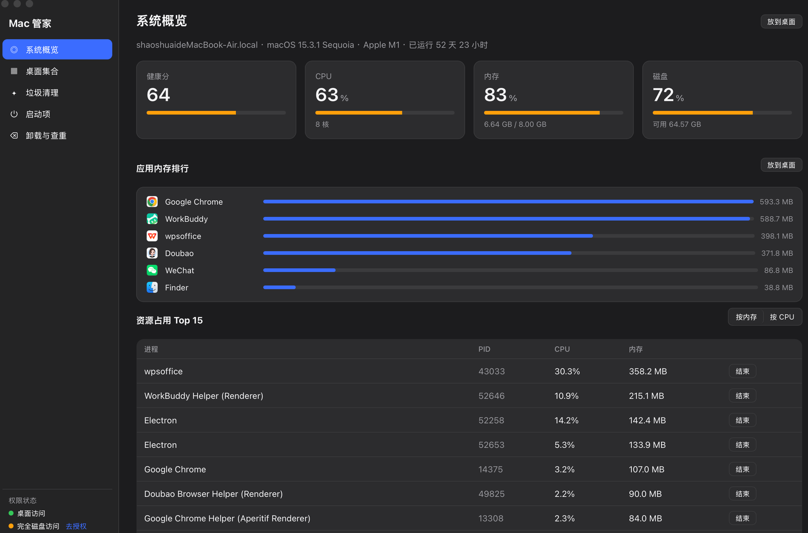
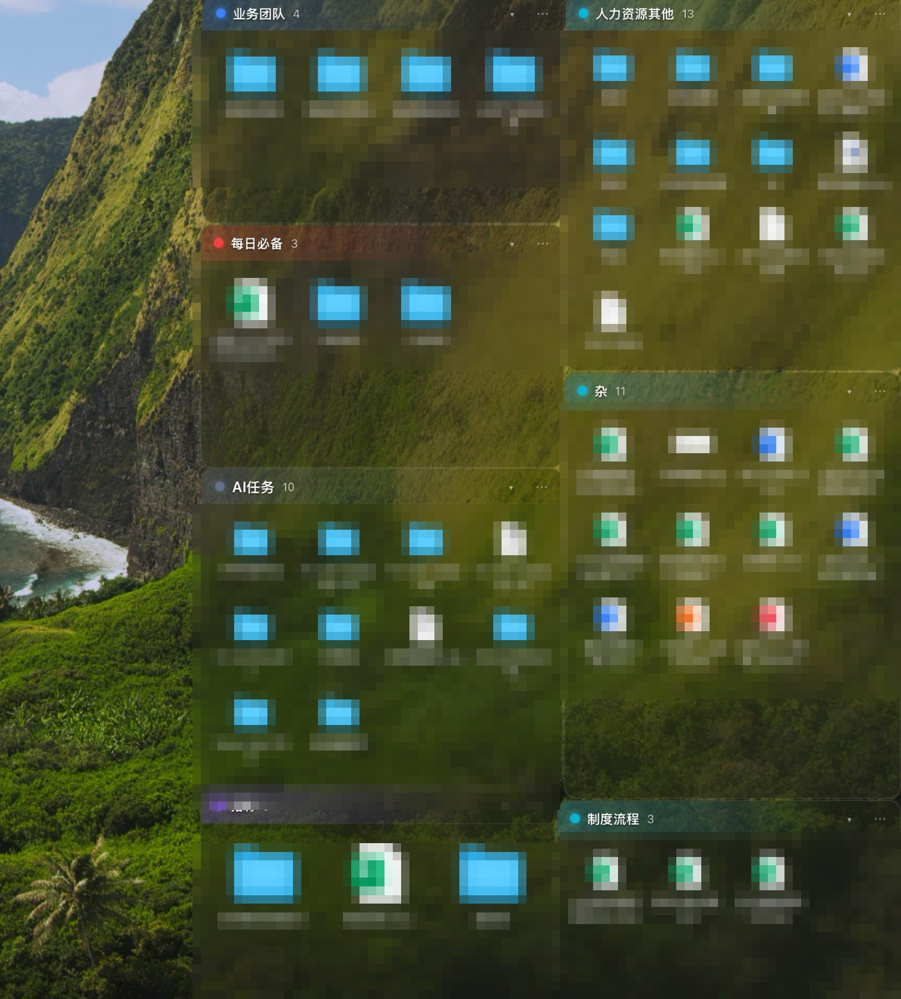
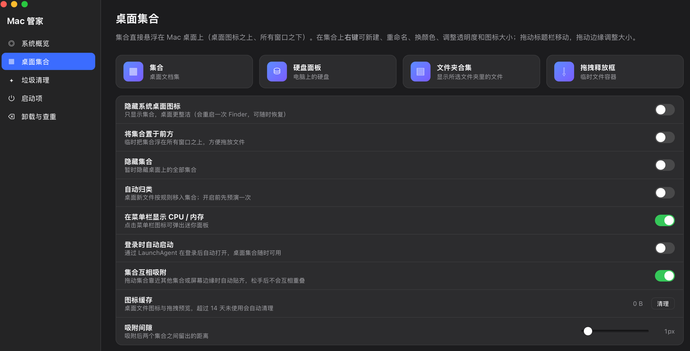
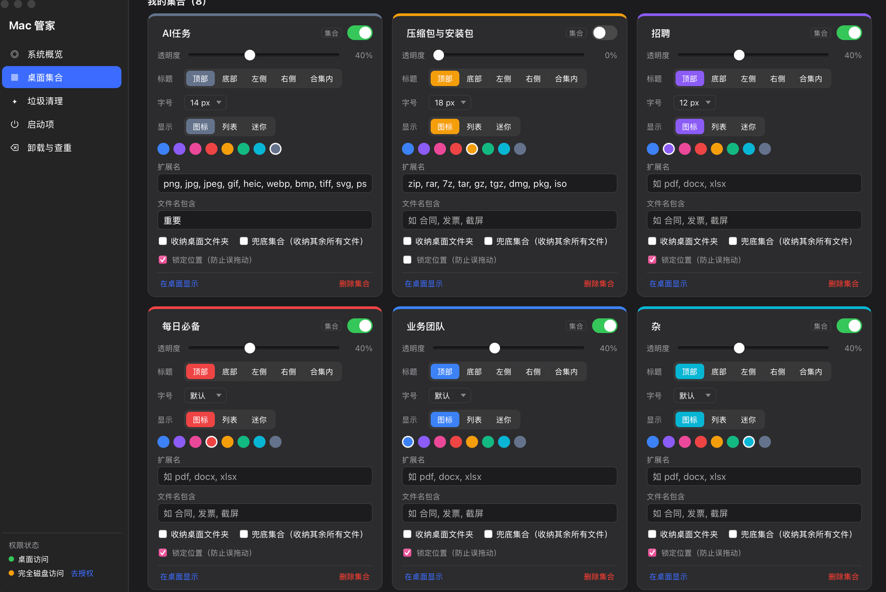
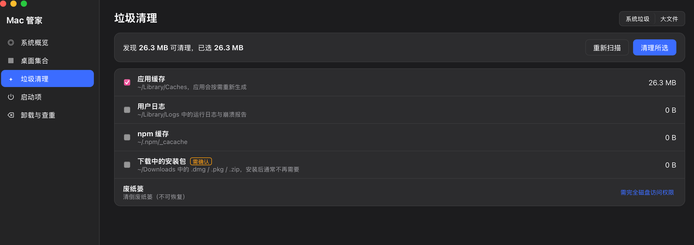

<div align="center">

# Mac 管家 · mac-butler

**桌面收纳 + 系统管家，一个 macOS 原生小工具搞定。**

把桌面文件收进浮在壁纸上的「集合」，顺手清理垃圾、卸载应用、盯住 CPU 和内存。

Tauri 2 构建 · DMG 2.3 MB · 空载约 30 MB 内存


</div>



---

## 为什么做这个

Mac 上「桌面乱」和「电脑慢」通常要用两个软件解决：一个整理桌面（iCollections 这类），一个清系统（各种管家）。前者贵且重，后者塞满广告和「一键加速」式的伪优化。

Mac 管家想把这两件事合到一个轻量工具里，并且立三条规矩：

- **不激进** —— 不做 `purge` 释放内存这种效果存疑的操作，不「一键加速」，每个动作都能说清做了什么。
- **可恢复** —— 所有删除走废纸篓，整理和归类都能撤销，启动项用 `launchctl disable` 而不是删 plist。
- **够轻** —— Tauri 用系统 WebKit，安装包 2.3 MB、空载 30 MB，不像 Electron 那样一装几百兆。

---

## 功能

### 一、桌面集合

每个集合是一个独立的透明窗口，直接浮在壁纸上方——不是应用内的面板，是桌面的一部分。



*桌面上同时开着几个集合。文件已经在集合里了，桌面本身是空的——为了展示效果，图中文件名做了模糊处理。*


- **像桌面图标，不像窗口**：无边框毛玻璃，不进 Dock、不进 Cmd+Tab、不进调度中心，跨 Space 常驻，点「置于前方」才浮到最上层。
- **四种形态**：集合（收纳盒子）、文件夹合集（映射任意文件夹）、拖拽释放框（临时中转，清空即回桌面）、硬盘面板（磁盘容量与快捷入口）。
- **文件只存一份**：拖进集合是真的移动到 `~/桌面集合/<集合名>/`，桌面上不再重复；集合之间拖动也是移动；拖出到 Finder 后集合里不再保留。
- **自动归类**：按扩展名 / 关键字 / 文件夹 / 兜底规则，1.5 秒内把桌面上新落地的文件收进对应集合。开启前先「预演」，列出哪些文件会去哪个集合，确认后才动手。
- **FSEvents 实时响应**：直接监听桌面与集合目录，文件一变就刷新，后台轮询降级为 30 秒兜底。
- **布局手感**：拖到边缘 18px 内自动吸附（拖动过程中实时吸附，不等松手）、可锁定位置、每个集合独立透明度、标题栏可放上下左右四边、图标 / 列表 / 迷你三种显示方式。
- **可撤销**：最近 200 次文件移动（放入 / 自动归类 / 移回桌面 / 拖出）逐条可撤销。
- **隐藏系统桌面图标**：一个开关换一张干净壁纸，走 `defaults write com.apple.finder CreateDesktop`，要确认才执行。

<p align="center">
  
  
</p>

*左：四种集合类型与全局开关。右：每个集合都能单独调透明度、标题位置、显示方式和归类规则。*

### 二、系统管家

| 能力 | 说明 |
|---|---|
| 垃圾清理 | 应用缓存、用户日志、Xcode DerivedData、iOS 备份、npm 缓存、下载中的安装包；分组勾选、展开明细、移到废纸篓 |
| 大文件 | 按 100MB / 500MB / 1GB / 4GB 筛选用户目录，直接看能腾出多少空间 |
| 应用卸载 | 扫描 `/Applications`，按 Bundle ID 找 `~/Library` 下的数据、缓存、偏好、容器、登录代理残留，应用和残留一起清 |
| 重复文件 | 大小 → 首块哈希 → 全文哈希三级过滤，按可释放空间排序，默认每组保留第一份 |
| 浏览器缓存 | Chrome / Edge / Safari / Firefox / Arc，运行中的浏览器拒绝清理 |
| 启动项 | 登录项可移除，`~/Library/LaunchAgents` 可开关（`launchctl disable`，可逆），`/Library/Launch*` 只读展示 |
| 资源监控 | CPU / 内存 / 磁盘仪表盘、健康分、进程 Top 15，按内存或 CPU 排序，可结束进程 |



*清理项按分组列出体积，勾选后一次性移到废纸篓——不是直接删。*

### 三、常驻与小组件

- **菜单栏**：托盘直接显示 `CPU% · 内存%`；左键弹出迷你面板（首次点击才创建窗口，平时不占内存），右键是完整菜单。
- **桌面小组件**：系统概览 / 内存排行两种，和集合同层浮在桌面上，小 / 中 / 大三档，也能拖边缘自定义大小。
- **内存排行**：按 `.app` 包聚合多进程内存，一个浏览器开十几个进程也不会误判成十几个「大户」。
- **开机自启**：写入 `~/Library/LaunchAgents`，无需签名即可生效。

---

## 安装

### 下载 DMG

**[⬇ 下载 MacButler_0.6.2_aarch64.dmg（2.3 MB）](https://github.com/111seek/mac-butler/releases/download/v0.6.2/MacButler_0.6.2_aarch64.dmg)**

双击挂载，把「Mac 管家」拖进「应用程序」。历史版本在 [Releases](https://github.com/111seek/mac-butler/releases)。

**系统要求**：macOS 12.0+，Apple Silicon（arm64）。

#### 首次打开：Gatekeeper 会拦一次

当前构建没有 Apple Developer ID 签名，也没公证，所以第一次打开会被 macOS 挡住。不同系统版本的处理方式不一样：

| 系统版本 | 怎么放行 |
|---|---|
| **macOS 15 (Sequoia) 及更新** | 「右键 → 打开」**已失效**——Apple 在 15 里移除了这个入口。先双击触发一次拦截，然后去 **系统设置 → 隐私与安全性 → 安全性**，点「仍要打开」，输密码确认 |
| macOS 14 (Sonoma) 及更早 | 右键点图标 → 选「打开」→ 再点一次「打开」 |

嫌麻烦的话，用终端一条命令跳过（等价于上面的授权）：

```bash
xattr -dr com.apple.quarantine "/Applications/Mac 管家.app"
```

> 为什么不做签名？见下方 [关于签名与公证](#关于签名与公证)。

### 从源码构建

前置：Xcode Command Line Tools、[Rust](https://rustup.rs)、[Bun](https://bun.sh)（或改用 npm）。

```bash
git clone git@github.com:111seek/mac-butler.git
cd mac-butler
bun install
bun run tauri dev     # 开发模式，前端热更新
bun run tauri build   # 产出 .app 与 .dmg 到 src-tauri/target/release/bundle/
```

---

## 首次运行与权限

Mac 管家需要动桌面文件、读废纸篓、管启动项，所以会碰到几层系统权限。应用侧边栏会显示当前状态并给出跳转按钮。

| 能力 | 需要的权限 | 说明 |
|---|---|---|
| 读取桌面 / 下载 / 文稿 | 「文件与文件夹」 | 首次访问时系统自动弹窗 |
| 读废纸篓、邮件、Safari 缓存、部分 Containers | **完全磁盘访问权限** | 无法自动申请，需手动在「系统设置 → 隐私与安全性」里添加 |
| 登录项、清倒废纸篓 | 「自动化」（Apple Events → System Events / Finder） | 首次操作时弹窗授权 |
| 结束他人 / 系统进程、改 `/Library/Launch*` | root | 当前只读展示，v1.0 用 privileged helper |

> **注意**：当前是 ad-hoc 签名，授权绑定到具体构建。升级到新版本后，完全磁盘访问这类授权会失效，需要重新添加一次。原因和解决办法见 [关于签名与公证](#关于签名与公证)。

---

## 安全设计

这是这个项目最在意的部分，写代码时按这几条硬约束来：

1. **白名单 + 规范化**：`clean_items` 只接受规则目录之下（且不等于根目录本身）的路径，并 `canonicalize`，防止 `../` 和符号链接逃逸。
2. **可恢复**：清理、大文件、卸载残留一律 `trash::delete` 进废纸篓。只有「清倒废纸篓」不可恢复，且有二次确认。
3. **可撤销**：文件移动记录写入 `~/Library/Application Support/mac-butler/`，按条撤销；同名冲突自动加序号。移不回去时保留集合，不让文件失联。
4. **可逆**：启动项用 `launchctl disable` 写入覆盖数据库，不删除 plist。
5. **前端无系统权限**：capabilities 只开 `core:default`，一切文件操作经过 Rust 命令和白名单校验。
6. **不做危险操作**：不结束自身进程，不碰 `purge`，不改 `sudoers`，不静默删除。

---

## 技术栈

| 层 | 选型 |
|---|---|
| 桌面壳 | Tauri 2（`macos-private-api`、`tray-icon`、`tauri-plugin-drag`） |
| 后端 | Rust 2021，`sysinfo` / `plist` / `trash` / `objc2-app-kit` |
| 前端 | React 19 + TypeScript + Vite |
| 原生交互 | `objc2` + AppKit 直接操作 `NSWindow`、`NSVisualEffectView`、`NSWorkspace`、`NSEvent`、`FSEvents` |

```
┌──────────────────────── Tauri App ────────────────────────┐
│  WebView (React 19)                                       │
│   Dashboard · Collections · CollectionWindow · Cleaner    │
│   Startup · Tools · Mini · WidgetWindow                   │
│        │  src/api.ts —— 类型化 invoke 封装                │
│  ──────┼────────────── IPC (invoke / JSON) ───────────────│
│  Rust  ▼                                                  │
│   lib.rs        命令注册、托盘、权限检测                    │
│   monitor.rs    CPU / 内存 / 磁盘 / 进程（共享 State）      │
│   collections.rs 桌面集合：窗口层级、拖放、移动、自动归类     │
│   widgets.rs    桌面小组件窗口                             │
│   watcher.rs    FSEvents 监听桌面与集合目录                 │
│   icons.rs      NSWorkspace 图标渲染（icon:// 协议）        │
│   cleaner.rs    垃圾规则、体积统计、废纸篓、大文件           │
│   apps.rs       应用扫描与残留查找                          │
│   dupfile.rs    三级哈希去重                               │
│   browsers.rs   浏览器缓存                                 │
│   startup.rs    plist 解析、launchctl、登录项               │
│   autostart.rs  LaunchAgent 自启                           │
│   util.rs       路径白名单、磁盘占用统计、命令执行            │
└───────────────────────────────────────────────────────────┘
```

几个实现上的取舍：

- **体积用 `st_blocks * 512` 统计**，和 Finder「磁盘上」一致，正确处理稀疏文件与 APFS 克隆。
- **耗时操作全部 `async`**，跑在 Tauri 线程池，不阻塞 UI。
- **后台线程合并**：松手吸附、节流写盘、目录检查合并成 1 个轮询线程；FSEvents 接管实时性后，轮询只做兜底。
- **图标缓存有预算**：内存缓存 16 MB 上限（不是按张数），磁盘缓存启动时清 14 天未用的。
- **release 编译**：`lto + strip + codegen-units=1 + panic=abort`，为体积和内存让路。

---

## 目录结构

```
mac-butler/
├── docs/DESIGN.md          完整产品与技术方案（竞品拆解、版本规划、踩坑记录）
├── docs/screenshots/       README 用的界面截图
├── src/                    React 前端
│   ├── api.ts              Rust 命令的类型化封装
│   ├── App.tsx             侧边栏 + 路由 + 权限状态
│   ├── pages/              Dashboard / Collections / CollectionWindow
│   │                       Cleaner / Startup / Tools / Mini / WidgetWindow
│   └── styles.css          macOS 风格样式（含深色模式）
└── src-tauri/              Rust 后端
    ├── Cargo.toml / tauri.conf.json / capabilities/ / icons/
    └── src/                见上方架构图
```

更多设计细节——包括桌面窗口层级怎么选、TCC 权限怎么踩坑、版本演进为什么这么排——都在 [`docs/DESIGN.md`](docs/DESIGN.md)。

---

## 路线图

- [x] v0.1 系统概览、桌面收纳盒、垃圾清理、大文件、启动项
- [x] v0.2 应用卸载器、重复文件、浏览器缓存、菜单栏实时数据
- [x] v0.3 桌面悬浮集合（透明窗口、拖放移动、自动归类）
- [x] v0.4 集合外观：透明度、吸附、标题位置、显示方式
- [x] v0.5 锁定、资源占用优化、最近移动撤销
- [x] v0.6 开机自启、菜单栏迷你面板、FSEvents、桌面小组件
- [ ] v1.0 Developer ID 签名 + 公证、自动更新、privileged helper、上架外分发

---

## 已知限制

- 放进集合的文件实际位于 `~/桌面集合/`，其他应用按旧桌面路径访问会找不到——这是「只存一份」的代价。
- 登录项通过 AppleScript 读取，macOS 13+ 由 `SMAppService` 注册的后台项目不会出现在列表里（需要 `sfltool dumpbtm`，要 root）。
- 开启 `macOSPrivateApi` 后不能上架 Mac App Store；本项目本身也需要完全磁盘访问与非沙盒文件操作，所以走 DMG 分发，和同类产品一致。
- 目前只提供 arm64 构建。
- **升级后系统权限需要重新授权**：当前是 ad-hoc 签名，macOS 把每次构建当成不同应用，完全磁盘访问、自动化这些授权会在更新后失效，得手动再给一次。这是没买 Developer ID 的直接代价（见下节）。

---

## 关于签名与公证

这个项目目前是**未签名、未公证**分发，原因很实在：Apple 的公证只能配 Developer ID 证书用，而 Developer ID 证书只有付费的 Apple Developer Program（$99/年）才能签发。免费 Apple ID 只能签 development / ad-hoc 证书，拿去提交公证会被直接拒绝（`The binary is not signed with a valid Developer ID certificate`）。

会费豁免也有，但只给**非营利组织、教育机构、政府机构**这类法人实体，条款里明确排除「个人、独资企业或一人公司」——个人开源项目不适用。

所以现阶段的做法是：把放行步骤写清楚，用户点一次「仍要打开」即可。

$99 真正买到的**不只是少一个弹窗**，而是另外三件事：

1. **权限不再每次更新重置** —— ad-hoc 签名的 designated requirement 绑定构建哈希，升级一次就变成「新应用」，完全磁盘访问要重给。对一个要读桌面和 `~/Library` 的工具，这个体验损耗比 Gatekeeper 弹窗大得多。
2. **能用官方 Homebrew cask** —— Homebrew 从 5.0 起要求 cask 必须签名并公证，2026 年 9 月起官方 tap 里未签名的 cask 已全部禁用（自建 tap 不受限，但 `--no-quarantine` 这个绕过参数也一并废弃了）。
3. **死链风险归零** —— 证书被吊销或到期，已安装用户还能跑，但新下载会被拦。

打算认真维护这个项目时会补上，路线图里挂在 v1.0。

---

## 贡献

Issue 和 PR 都欢迎。动手前建议先读 [`docs/DESIGN.md`](docs/DESIGN.md)，里面有窗口层级、权限、性能预算这些容易踩坑的结论，能省不少时间。

提 PR 时请保持这几条：删除动作必须走废纸篓、新增的清理路径必须纳入白名单校验、不要引入阻塞 UI 的同步命令。

---

## License

[MIT](LICENSE) © 2026 seek-shao

<div align="center">

如果这个工具帮你收拾干净了桌面，点个 ⭐ 是最高效的反馈。

</div>
